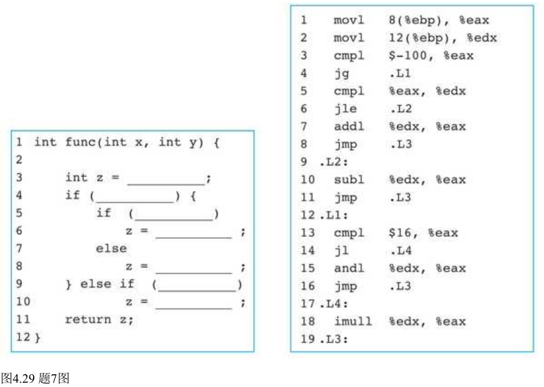

# 读到这里你就可以去做教材第四章第7题了！

> 教材原题 · PDF 第960–961页

7. 已知函数`func()`的C语言代码框架及其过程体对应的IA-32汇编代码如图4.29所示，根据对应的汇编代码填写C语言代码中缺失的表达式。

[](../assets/homework/book4-figure-4-29.png)

> 图中汇编文字转录，供复制与逐行跟踪；上方原图保留完整填空框架。

```asm
movl 8(%ebp), %eax
movl 12(%ebp), %edx
cmpl $-100, %eax
jg .L1
cmpl %eax, %edx
jle .L2
addl %edx, %eax
jmp .L3
.L2:
subl %edx, %eax
jmp .L3
.L1:
cmpl $16, %eax
jl .L4
andl %edx, %eax
jmp .L3
.L4:
imull %edx, %eax
.L3:
```

## 提示1：先确定分析对象

先不要填`z`。把能到达每个标号的`x`范围写出；`jg`与`jl`都是有符号比较，`cmpl %eax,%edx`比较的是`y-x`。

## 提示2：把关键步骤展开

四条结果路径为：`x<=-100`且`y>x`时相加；`x<=-100`且`y<=x`时相减；`x>-100`且`x>=16`时按位与；其余范围相乘。最后一条相乘路径决定未进入两个C分支时应保留的默认值。

## 完整解答与核对

符合图中框架的一种填写如下。这里给出完整C函数，名称加前缀以便和其他练习区分。

```c
int hw_func(int x, int y) {
    int z = x * y;
    if (x <= -100) {
        if (y > x)
            z = x + y;
        else
            z = x - y;
    } else if (x >= 16) {
        z = x & y;
    }
    return z;
}
```

七处空格依次可填`x*y`、`x<=-100`、`y>x`、`x+y`、`x-y`、`x>=16`、`x&y`。内层条件也可反写并交换两项赋值，前提是框架允许这样填写且逻辑相同。

第一条`jg .L1`使`x>-100`跳过加减分支，所以留在该分支的是`x<=-100`。进入后，`jle .L2`判断`y<=x`，该路径做`x-y`；未跳转的`y>x`路径做`x+y`。在`.L1`里，`jl .L4`使`x<16`走乘法，未跳转的`x>=16`走按位与。

C中的初始化`z=x*y`提供默认结果，编译器可以把真正乘法推迟到只需要它的路径，所以汇编入口暂存`x`，不要求先无条件算乘积。填写源码与阅读寄存器当前值要分开；不能据入口`EAX=x`就把`z`的默认值填成`x`。

边界核对：`(-100,-99)`得到−199，`(-100,-101)`得到1，`(-100,-100)`得到0；`(-99,2)`得到−198；`(15,3)`得到45；`(16,3)`得到0。前后三组分别检查−100、16及`y=x`边界。

按C语义使用上面函数时，初始化乘积也必须可表示，即使后续分支会覆盖`z`，仍不能把源程序中的有符号溢出忽略。机器指令可按低32位追踪；讲义的C运行测试选取中间运算不溢出的样例。
